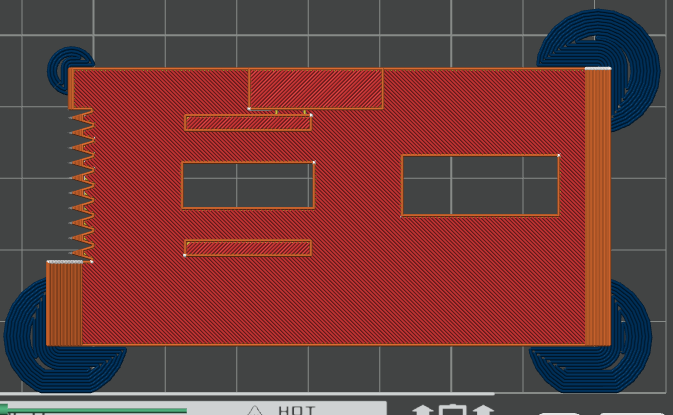

# 3D-printed-tape-dispenser-with-mechanical-tape-length-measuring
A 3D printed tape dispenser that shows you how long a piece of tape you're pulling out is before you cut it. Works best for washi tape or paper-like tape, because the tape cutter is 3D printed and not very sharp

# Printing instructions
The best way is to slice the 'Ship 1 both plates slicer file.3mf' file in Bambu studio, as it should import with the required printing settings. Otherwise, follow the instructions below.

## Orientation
- All parts are oriented correctly in the .3mf file
- If using inividual .step files, automatic orientation works for all pieces - none of them need unusual orientations

## Supports
Only around 3.5g of support is needed, so if you follow these instructions, you should get a similar result:
- turn on tree supports for the bearing casing and tray parts
- turn on normal supports for the bearing holder part

## Brims (in the pictures, the brim is blue)
- add brim ears at each corner of the tape cutter part like so 

- add an outer brim to the driven axle/secondary axle part
- add brim ears on either end of the chain like so

