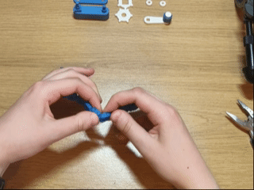

# 3D-printed-tape-dispenser-with-mechanical-tape-length-measuring
A 3D printed tape dispenser that shows you how long a piece of tape you're pulling out is before you cut it. Works best for washi tape or paper-like tape, because the tape cutter is 3D printed and not very sharp

# You will need (more details in BOM)
- 3D printer filament (PLA or other rigid filament)
- A 8x22x7mm ball bearing (you might be able to 3D print one from someone else's file)

# Printing instructions
The best way is to slice the 'Ship 1 both plates slicer file.3mf' file in Bambu studio, as it should import with the required printing settings. Otherwise, follow the instructions below.

## Orientation
- All parts are oriented correctly in the .3mf file
- If using inividual .step files, automatic orientation works for all pieces - none of them need unusual orientations

## Supports
Only around 3.5g of support is needed, so if you follow these instructions, you should get a similar result:
- turn on tree supports for the bearing casing and tray parts
- turn on normal supports for the bearing holder part

## Brims (in the pictures, the brim is dark blue)
- add brim ears at each corner of the tape cutter part like so 

- add an outer brim to the driven axle/secondary axle part
- add brim ears on either end of the chain like so

- if any other parts are causing warping or adhesion issues, add an outer brim

## Main settings/instructions
- PLA or any other rigid filament can be used
- 0.2mm layer height is suitable
- 2 wall loops, 15% infill is suitable

# Assembly instructions
For simplicity, the assembly instructions are broken up into 6 sections:
1) The chain
2) The driven axle/secondary axle
3) The driving axle/primary axle
4) The tape recovery system
5) Attaching the axles
6) Finishing the tape dispenser

## 1) The chain
1. Rotate each link in the chain so that it can articulate. You'll probably need pliers to free the two end links, but be careful not to crush them when gripping them with the pliers.
   

2. Rotate the chain into a loop so that the side on the build plate is on the outside. Use a dab of superglue on the dovetail joint where the chain needs join and push the dovetail pin into the socket. I'd recommend using a cocktail stick or something similar to apply the glue to avoid gluing your fingers or jamming the chain.
   

## 2) The driven axle
1. Put the driven gear on the driven axle

2. Put the axle spacer on the axle, with the chamfered end towards the driven gear

3. Put the number cylinder on the axle, with the numbers going upwards in the clockwise direction

4. Put the axle holder on the axle, with the screw pointing away from the number cylinder

## 3) The driving axle
