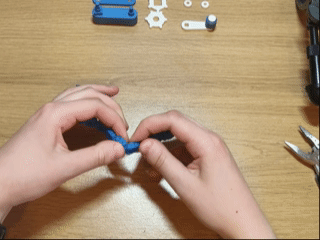
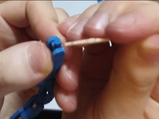
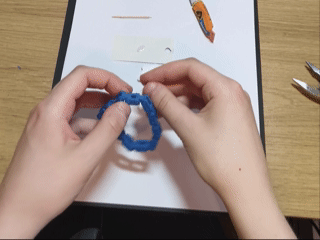
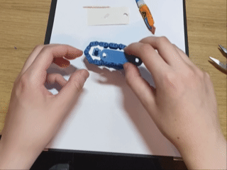

### This was a side project I did during the making of the tape dispenser.

## Origins
Since the tape dispenser design required a chain, but I hadn't designed a chain or even a sprocket before, I decided to make a test rig for a couple of sprockets (the driving & driven gears) and a 3D printed chain. If I made sure the gears in the test rig were the same distance apart as in the tape dispenser, I could replicate the conditions of the chain rotating as if it were in the tape dispenser, but without all the extra complexity. This meant that all the improvements to the chain & sprocket test rig would directly benefit the chain & sprockets in the wider tape measure assembly at the end.

This side project really helped me, because without it, there's no way my chain would be as smooth as it is now. It also had the added benefit of being fun to play with, so I uploaded it to [Makerworld](https://makerworld.com/en/models/3051957-chain-sprocket-mechanism#profileId-3433460) and [Printables](https://www.printables.com/model/1781538-chain-and-sprocket-mechanism)

**This model is optional to print**, but if you'd like to make it, I've provided the .3mf file & separate .step files 

# Printing instructions
Use the .3mf file in Bambu studio to have all the settings set already, otherwise follow these settings:
- Disable prime tower for the handle colour change
- No supports
- Keep the layer height at or below 0.2mm so that the screw threads can be printed to a high quality
- Paint brims under each end link for the chain (see picture below)

# Assembly guide
1. Rotate each link in the chain so that it can articulate. You'll probably need pliers to free the two end links, but be careful not to crush them when gripping them with the pliers.

2. Rotate the chain into a loop so that the side on the build plate is on the outside. Use a dab of superglue on the dovetail joint where the chain needs join and push the dovetail pin into the socket. I'd recommend using a cocktail stick or something similar to apply the glue to avoid gluing your fingers or jamming the chain.

3. While the glue is drying, rotate the square axle in the base and the rotating cylinder in the handle to allow them to freely rotate.

4. Once the glue is dry, insert the gears into the chain one after the other, making sure the teeth are meshing with the chain. Pick up the gears at the same time while keeping them apart so that the chain is taut and doesn't fall off. Place the gears onto their respective axles on the base part. 

5. Put the top part on, making sure the big hole goes on side with the longer axle. Screw one of the nuts onto the shorter axle. Put the handle on the longer axle, and tighten the second nut down over it.

### FINISHED! It may feel a little stiff at first, but it should be buttery smooth after a few turns of the handle

 
